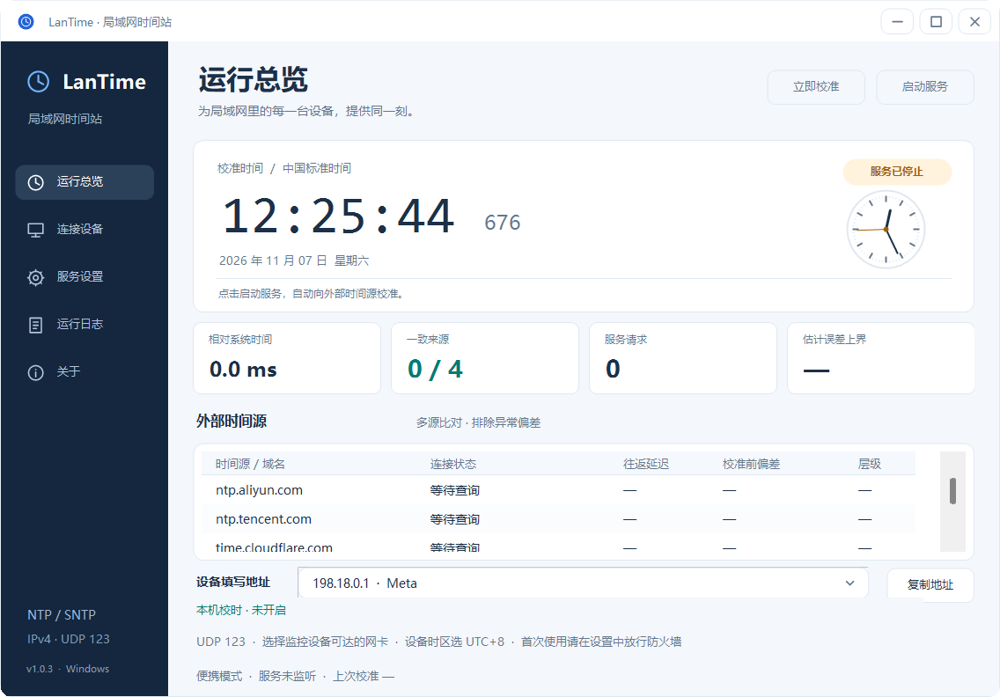

# LanTime · 局域网时间站

Windows 本地 NTP/SNTP 时间服务端，用于摄像头、NVR、监控平台和其他局域网设备校时。版本 1.0.3。



作者：**chengkai**。网站：[https://nnu.cn](https://nnu.cn)。

界面采用统一的圆角输入框、开关、下拉选择、按钮、表格及四角圆润的窗口与提示弹窗。文本编辑保留中文输入、选择、复制粘贴和键盘行为。

“关于”页面提供可点击的网站链接、作者信息和可滚动查看的完整 MIT 开源协议。协议同时嵌入 EXE 并以 `LICENSE.txt` 随包提供；即使删除外部协议文件，程序内仍可查看完整条款。侧栏、关于页、窗口与托盘使用统一绘制的居中图标，EXE 图标提供多个尺寸。

## 下载与版本选择

- **安装版：** `LanTime-1.0.3-Setup.msi`。双击按 Windows 提示安装，提供开始菜单、桌面入口与卸载项。程序位于 Program Files，配置和日志位于 `%ProgramData%\LanTime`；启动界面请求管理员权限。卸载保留配置和日志。
- **便携版：** `LanTime-1.0.3-Portable.zip`。完整解压后运行 `LanTime.exe`，配置和日志位于 EXE 同级 `data`，可随目录携带。
- 两种版本都需要 .NET Framework 4.0 完整版或兼容的 4.x。安装包会检测运行库；不会静默下载、安装运行库或自动添加防火墙和后台服务。
- 如果已经将便携版安装成 Windows 后台服务，请先在旧版界面卸载该服务，再切换到 MSI 安装版。安装版维护操作仅停止 / 删除指向该安装目录的 LanTime 服务。
- 源码：[GitHub](https://github.com/anyfrees/lantime) · [CNB](https://cnb.cool/nnu/lantime)。两个仓库使用相同提交同步。

## 便携版五分钟开始使用

1. 将压缩包**完整解压**到固定、可写的本地目录，例如 `D:\LanTime`。不要直接在压缩包内运行。
2. 双击 `LanTime.exe`。便携模式会自动启动 UDP 服务并向外部时间源校准。等状态变成“已同步”。
3. 打开“服务设置”，点击“允许局域网访问”，同意 Windows 管理员权限提示。规则仅放行专用网络和域网络；如果本机网络被标记为公用网络，请在 Windows 网络设置中将实际局域网设为专用/工作网络。
4. 回到“运行总览”，在“设备填写地址”下拉框选择监控设备能访问的网卡，点击“复制地址”。有 VPN、虚拟网卡时尤其要选对网卡。
5. 在监控设备中启用 NTP，服务器填写上一步的 IPv4 地址，端口填 `123`，时区选 `UTC+08:00 / 北京时间`。设备建议每 5—30 分钟校时一次。
6. 查看“连接设备”：如果出现设备 IP 和累计请求，说明请求已到达并收到应答。最终是否应用时间，需要在设备端核对。

建议给时间站电脑设置固定内网 IP 或 DHCP 地址保留，防止重启后地址变化。

## 系统要求与实际验证范围

- 目标系统：Windows 7 / 8 / 8.1 / 10 / 11，32 位和 64 位。程序为 AnyCPU，使用 .NET Framework 4.0 API 和原生 WinForms，不依赖浏览器、WebView2、Python、Node.js 或 VC++ 运行库。
- 必须安装 **.NET Framework 4.0 或兼容的 4.x**。Win7 原装通常不具备此运行库；Win10/11 通常已具备兼容的 4.x。
- 原始 Win7 可安装 [.NET Framework 4.0 官方离线安装程序](https://www.microsoft.com/en-us/download/details.aspx?id=17718)。Win7 SP1 可按[微软系统要求](https://learn.microsoft.com/en-us/dotnet/framework/get-started/system-requirements)选用 .NET Framework 4.8。
- 适合 1024×768 及以上桌面；窗口可以缩放，设置页可滚动。
- 已在当前 Windows 11 / .NET Framework 4.x 环境完成编译、74 项功能和 47 项界面检查、真实 UDP 123 收发和外部 NTP 连接检查。
- **尚未在 Win7 实机或虚拟机中验收**。兼容性来自 .NET 4.0 API、AnyCPU 和 Win7 可用的系统调用约束，不能将其视为已完成 Win7 实机认证。
- 已测试后台服务类的启动、状态写入和停止生命周期；没有在本机实际安装 SCM 服务、修改防火墙或执行开机启动验收。

## 提供的功能

- 深蓝/浅色桌面仪表盘：校准时间、系统偏差、多源状态、估计误差、累计请求。
- 支持 NTPv3 / NTPv4 客户端的 IPv4 单播模式（客户端 mode 3、服务端 mode 4），标准 48 字节应答，默认 UDP 123。
- 默认外部源：`ntp.aliyun.com`、`ntp.tencent.com`、`time.cloudflare.com`、`time.windows.com`；可以在界面增删，支持 2—12 个来源。
- 多源并行查询，每来源每轮取两个样本中的最低延迟样本；DNS 与 UDP 查询均有超时。
- 至少两个不同解析 IP 的来源，且在有效独立来源中占严格多数、偏差落在 100 ms 窗口、闰秒标记相同，才接受校准。取一致来源偏差的中位数；重复 IP 不重复计票。
- 校验响应模式、版本、层级、未同步状态、拒绝报文、原始请求时间戳、接收/发送时间戳和往返延迟。
- 初次同步建立独立的校准时钟；后续小幅调节采用最大 1000 ppm 的平滑修正，避免已同步的服务时钟倒退。大偏差收敛期间标记未同步。过期后重新取得多数一致时会重新建立时间基准。
- 默认每 300 秒自动校准，手动校准最短间隔 30 秒；自动间隔可设 60—86400 秒。
- 断网后默认保持 3600 秒；保持期间估计误差按 100 ppm 增长。超过时限后应答标记 LI=3 / Stratum=16，不能当作可信同步源。首次校准前也使用这一标记。
- 休眠恢复后取消同步可信状态，重新获取外部时间。
- 默认仅允许回环、RFC1918 私有 IPv4 和 IPv4 链路本地网段，支持自定义 CIDR；默认不向公网开放。
- 单 IP 每秒最多处理 10 个请求、总计每秒 500 个；只处理客户端校时报文，不处理管理查询和放大类请求。
- 按 IP 记录设备，内部最多保留 1024 个，界面显示最近 200 个；运行日志轮转保留约 4 MB。
- 关闭窗口收起到系统托盘。便携模式真正退出：右键托盘图标 → 退出界面并停止服务。
- 当前用户登录自启选项，以及独立的 Windows 开机后台服务模式。

## 自动校准这台电脑的 Windows 时间

1. 在“服务设置”勾选 **自动校准本机 Windows 时间**，点击“保存设置”。该开关默认关闭，升级旧配置不会自动启用。
2. 便携模式会请求管理员权限并重新打开程序。授权后，首次多源比对成功便会校准；以后按“自动校时间隔”执行，默认每 300 秒。点击“立即校准”也会触发新一轮比对，最短间隔 30 秒。
3. 在运行总览查看“本机校时”，可看到“校准成功 / 时间一致 / 需要校时权限 / 等待一致时间”等状态以及最近成功时间；设置页提供详细原因，日志记录调整量和失败原因。
4. 本机偏差不足 50 ms 时显示“时间一致”，避免频繁跳时；达到门槛后使用 Windows UTC 校时接口直接校准，可向前或向后修正，不改时区。
5. 只有本轮至少两个独立 IP 的来源达到多数一致才调整系统时间。来源不足、分歧或断网保持时不重复写入旧时间；休眠恢复要先重新取得一致时间。
6. 若要无需登录、无需每次弹出权限提示，使用“安装开机后台服务”，保存此开关并启动后台服务。LocalSystem 服务同样支持本机自动校时。便携模式的“登录自启”仍受 Windows 管理员授权约束。

权限由 Windows 的“更改系统时间”策略决定。取消授权或系统策略不允许时，本机校时会明确报错，局域网授时仍可继续。若电脑已由域策略、Windows 自动时间或其他软件管理时间，应由管理员决定由谁负责，避免多个程序反复调整。本软件不会自动停用 Windows Time 或修改其策略；如果 Windows Time 占用 UDP 123，仍需解决原有端口冲突。

测试覆盖 Windows 时间接口的 UTC 数据转换、模拟时钟写入与回读验证、真实回环 NTP 多源触发、来源分歧、权限失败、休眠恢复和服务生命周期。**本轮没有实际调用 Windows 改时接口改变测试电脑时间，也没有完成 Win7 实机或 SCM 开机验收。**

## 关于准确度

软件通过公网 NTP 多源比对改善局域网设备时间一致性。**“最新”和“最准确”取决于可达的上游、链路延迟/不对称、电脑硬件时钟和操作系统调度；软件不承诺固定的毫秒级或计量级精度。**

界面“估计误差上界”综合了上游报告的根延迟/离散度、往返延迟、来源之间的分歧、16 ms 本地时间分辨率余量、保持漂移和剩余平滑偏差。这是按假设计算的保守估计，不是经授时仪器标定的保证。来源状态中的“校准前偏差”表示该轮查询时相对软件时钟的偏差，不是当前的剩余误差。

未开启“自动校准本机 Windows 时间”时，校准后的独立时钟用于向设备应答，Windows 任务栏时间可能不同。开启后，每轮多源比对通过会同时校准本机 Windows 时间。NTP 报文使用 UTC；界面使用本机时区，设备自己处理北京时间和夏令时。

实现定位是监控场景的 NTP/SNTP 单播服务，不是完整 RFC 5905 算法套件，也不提供 NTS、认证、GPS/PPS、PTP、广播或 IPv6。来源“独立”仅指解析 IP 不同，不代表经过密码学验证。自定义来源时，请避免混用 leap smear 和传统闰秒来源。

## 无需登录的开机后台服务

1. 先把整个目录放在最终固定位置，保存所需的时间源、监听地址和网段设置。
2. 在“服务设置”点击“安装开机后台服务”，按提示授予管理员权限。安装前便携监听会先停止，安装操作本身不会立即启动后台服务。
3. 界面会自动切换到“后台服务模式”。点击“启动服务”并按提示授予管理员权限，确认状态“已同步”。
4. Windows 服务名为 `LanTimeNtp`，显示名为“LanTime 局域网时间站”，设置为自动启动并配置失败重启。之后即使没有用户登录也可运行。
5. 后台模式退出界面不会停止后台服务；界面的启动、停止和立即校准操作通过服务控制完成，需要管理员权限。
6. 修改配置时，先在界面停止后台服务，保存设置，再启动服务。修改端口或网段后，请先移除旧防火墙规则，再点击“允许局域网访问”。
7. 卸载：先点击“卸载后台服务”，再移除防火墙规则。此后可删除文件夹。安装期间不要移动或重命名程序目录。

服务使用 Windows 默认的 LocalSystem 身份。用于长期后台运行时，应放在由管理员控制的固定目录，按本机管理规范设置目录权限；界面也需要对 `data` 具有配置写入权限。

## 常见问题

**提示无法监听 UDP 123**

通常是 Windows Time（W32Time）或其他校时软件占用。程序不会自动停止其他服务。请由管理员检查占用者，决定哪个软件负责授时；设备通常需要标准端口 123，改端口前确认设备支持。

PowerShell（支持该命令的较新 Windows）查看：`Get-NetUDPEndpoint -LocalPort 123`

Win7 可用管理员命令提示符：`netstat -ano -p udp`，在结果中查找本地 `:123`，再通过任务管理器核对 PID。

**一直等待首次校准**

查看来源状态与运行日志。确认电脑可访问外网 DNS、允许出站 UDP 123，至少两个不同 IP 的来源返回一致时间。HTTP 代理通常不能转发 NTP 的 UDP；部分公司网络或运营商会拦截 UDP 123。只有一个来源成功时，不会降低多源要求冒充已同步；可以替换不可达的来源。

**本机已同步，但监控连接设备列表为空**

检查设备服务器 IP、端口、网络路由、防火墙网络类别和允许网段。特别注意没有选到 VPN/虚拟网卡。对于 `100.64.0.0/10` 等非默认私网地址，需要在软件中显式添加其实际允许网段，并重新配置防火墙规则。

**设备出现但时间不对**

先看时间差是否刚好 8 小时，若是则检查设备时区。再检查设备是否报告 NTP 同步成功、是否使用另一个自动校时来源、是否缓存旧配置，以及软件是否处于“已同步”。

**改端口后防火墙仍不通**

先保存软件设置，再“移除防火墙规则”，最后“允许局域网访问”。防火墙规则绑定当前 EXE 路径；移动程序后要重新创建规则。

**目录没有写入权限**

请解压到可写目录，或按管理员管理规范授予当前用户对 `data` 的写权限。便携版配置、服务快照和日志放在 EXE 同级 `data`；安装版放在 `%ProgramData%\LanTime`。不要使用只读光盘、压缩包内部路径或不可写的网络位置。

## 文件说明

- `LanTime.exe`：程序，包含界面与后台服务入口。
- `LanTime.exe.config`：.NET 运行时配置，请与 EXE 放在一起。
- `data/settings.json`：配置；通常通过界面修改。监听运行期间不要直接修改文件。
- `data/lantime.log`：运行日志；`lantime.log.1` 为上一段。
- `data/status.json`：后台服务状态快照，仅后台模式生成。
- `使用说明.txt` / `README.md`：使用说明。
- `测试报告/`：协议、UDP、服务生命周期和当前网络外部来源检查记录。
- `源码/`：全部 C# 源码、图标、清单、编译脚本和运行时配置。

## 从源码编译与检查

无需安装 Visual Studio 或额外 NuGet 包，只需要 .NET Framework 4.x 自带的 C# 编译器。

在 `源码` 目录双击 `build.cmd`，或者在 PowerShell 3.0+ 中执行 `powershell -ExecutionPolicy Bypass -File .\build.ps1`，输出在该目录的 `release` 文件夹。源码中的 PowerShell 脚本为构建用途，软件运行无需 PowerShell。

诊断命令（在可写目录中执行，GUI EXE 的命令行输出可使用重定向）：

```text
LanTime.exe --self-test "D:\LanTime\test-results.txt"
LanTime.exe --probe 127.0.0.1 123 > probe.txt
LanTime.exe --upstream-check "D:\LanTime\upstream-results.txt"
```

自检使用临时目录和临时 UDP 端口，不改系统时间、注册表、防火墙或 SCM 服务安装状态。服务类生命周期通过测试进程内调用验证。`--probe` 需要目标 NTP 服务已经运行。

外部测试记录来自当前构建网络。当时 DNS 返回 `198.18.*` 地址，说明测试路径经过该网络的 DNS/代理层；记录证明此网络路径返回了可用 NTP 报文，不代表独立于网络代理的 UTC 精度认证。

## 参考

- [NTP 报文和四时间戳计算：RFC 5905](https://www.rfc-editor.org/rfc/rfc5905)
- [微软 .NET Framework 4.0 官方下载及系统要求](https://www.microsoft.com/en-us/download/details.aspx?id=17718)
- [微软 .NET Framework 系统要求](https://learn.microsoft.com/en-us/dotnet/framework/get-started/system-requirements)
- [Cloudflare NTP 时间服务](https://developers.cloudflare.com/time-services/ntp/)
- [阿里云 NTP 服务说明](https://help.aliyun.com/en/ecs/user-guide/alibaba-cloud-ntp-server/)
- [腾讯云 NTP 服务说明](https://main.qcloudimg.com/raw/document/intl/product/pdf/cn_213_15384_zh.pdf)
- [微软 Windows 时间服务说明](https://learn.microsoft.com/en-us/windows-server/networking/windows-time-service/how-the-windows-time-service-works)

源代码按随附 MIT 许可证提供。

## 从源码构建

Windows 上执行 `powershell -ExecutionPolicy Bypass -File .\build.ps1` 构建应用。打包执行 `powershell -ExecutionPolicy Bypass -File .\package.ps1`，生成安装版 MSI、便携 ZIP 与 SHA256 校验值。

打包脚本使用本机 .NET Framework C# 编译器、Windows Installer COM 与 `makecab.exe`，无须安装 Inno Setup / WiX。打包脚本需要 Windows PowerShell 5.1 或 PowerShell 7；应用仍使用 .NET 4.0 API，目标 Win7 及以上系统。`dist/verification` 保存本次功能和界面检查结果。`package.ps1 -SkipMsi` 仅生成便携版。

安装包验收范围见 [发布校验记录](docs/RELEASE-VERIFICATION.md)。
